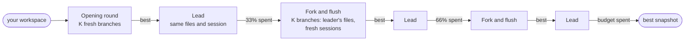
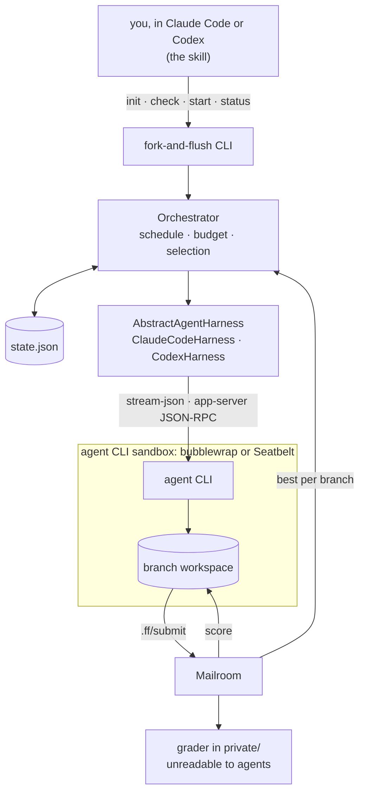
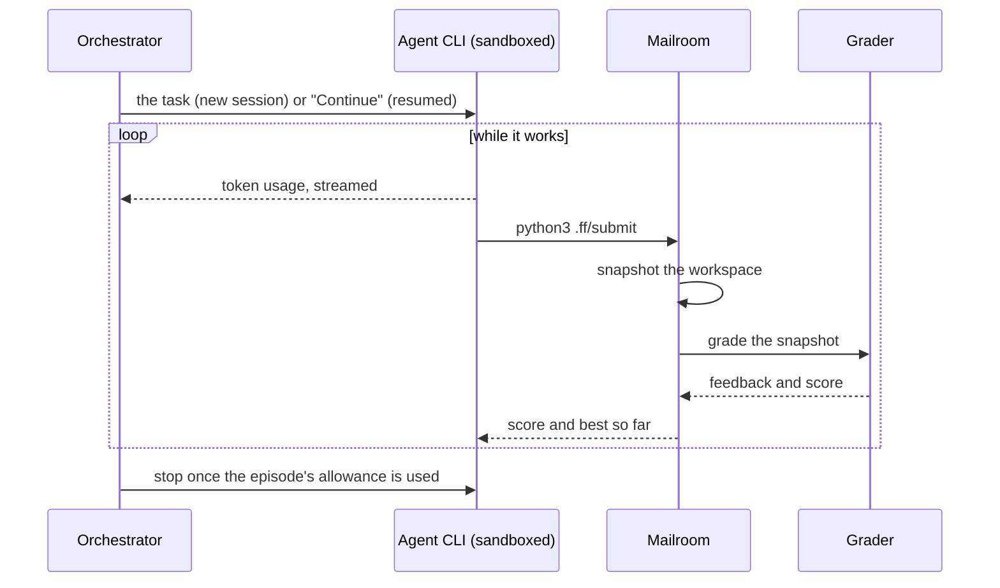

# fork-and-flush

Fork-and-flush for **Claude Code** and **Codex**: run a research agent for hours or days on a problem
with a numeric score, and periodically fork it into fresh-context branches, keeping the best.

## The paper

[Fork-and-Flush: Escaping Idea Basins in Autoresearch Agents](https://arxiv.org/abs/2610.07447)
(Cai, Ziakas et al., Microsoft Research, 2026) observes that independent runs of the same agent on the
same task plateau at very different scores. Each run stays in one family of approaches, an *idea
basin*, and compacting its chat history does not get it out. The fix is periodic:

- **fork:** start K branches, each with its own copy of the current files;
- **flush:** give every branch a fresh chat context, so it re-derives its intent from the files;
- **select:** the best-scoring branch continues; the others are discarded.

With K=4, about 6% of the budget per branch and forks at 33% and 66%, it beat a single run by 66% and
best-of-4 by 44% (normalized score, equal compute) across 13 long-horizon tasks.

## Install

```sh
uv tool install git+https://github.com/yikerman/fork-and-flush   # the CLI
```

| Agent | Plugin (the setup skill) |
| :- | :- |
| Claude Code | `/plugin install fork-and-flush --marketplace yikerman/fork-and-flush` |
| Codex | `codex plugin marketplace add yikerman/fork-and-flush`, then `codex plugin add fork-and-flush@fork-and-flush` |

Requires Linux or macOS, Python 3.9+, and `claude` or `codex`. On Linux the agents' sandbox needs
`bwrap` (and `socat` for Claude Code).

## Usage

Ask for a run in plain words, from Claude Code (or `/fork-and-flush:fork-and-flush`) or from Codex:

> Start a fork-and-flush run on `~/research/packing`. The goal is to make `solver.py` pack more
> rectangles. Score it with my benchmark in `~/research/packing-bench` and keep that hidden from the
> agents. Use Codex with gpt-6.1-sol at high effort and a 40M token budget.

The agent then sets the run up with you:

1. `fork-and-flush init ~/research/packing --agent codex --budget-mtok 40 --name packing`
2. writes `TASK.md` with you: the goal and rules in words, no budget, nothing about how it is scored;
3. writes `private/grader/grade.py` around your benchmark and puts the hidden data in `private/`;
4. asks whether the score depends on timing (if so: `parallel: 1`, `grader.exclusive: true`);
5. `fork-and-flush check packing`: grades the start twice, and has the agent try to read a canary
   in `private/`;
6. shows you `config.json` (model, effort, K, fork points, network) and waits for your go-ahead;
7. `fork-and-flush start packing`, which returns at once; the run continues in the background.

Later, from any session of either tool:

> How's the packing run doing? · Stop it for now. · It finished; put the best version into my repo.

These map to `fork-and-flush status`, `stop` (`start` resumes) and copying from `<run>/best`, a
read-only snapshot of the best submission. Runs live in `~/.local/share/fork-and-flush/runs/`.

**The grader** runs on a snapshot of a submission (`$FF_SUBMISSION`, also its working directory).
It prints feedback for the agent on stdout and the score as its last stdout line, higher is better.
stderr stays private, and a non-zero exit marks the submission invalid. It must be deterministic.

## Design philosophy

- **Around the agent, not inside it.** Like the paper, which wrapped an unmodified agent CLI, this is
  an orchestrator around unmodified Claude Code and Codex.
- **Documented interfaces only.** Agents are driven through their published headless protocols and
  confined by their own documented sandbox settings. No private files, no reverse engineering.
- **Intent, not implementation.** Agents get the goal in words and a score. The grader and test
  data are hidden by the sandbox, and `check` proves it, so agents cannot overfit to the scorer.
- **Tokens, not time.** The budget is weighted tokens, one unit for every agent. Parallelism only
  changes wall-clock time, so `parallel: 1` gives the same results.
- **Facts on disk, everything else derived.** Only facts are saved, after every episode and grade;
  totals, the best result and rounds are computed. A stopped or crashed run resumes where it was.
- **Small.** Standard library only; your workspace is copied, never modified.

## Implementation

The schedule (`state.plan`) is a fixed sequence of phases, each ending at a fraction of the budget:



The components:



One episode, with its submissions:



- **Harnesses** (`harness.py`): `claude -p --output-format stream-json`, and `codex app-server`
  (`thread/start`, `turn/start`, `thread/tokenUsage/updated`; OpenAI labels it experimental). A
  harness only says how to start its CLI, what to send, and how to read one JSON message.
- **Budget:** weights per token are input 1, cache read 0.1, cache write 1.25 and output 5. Usage
  streams in, so an over-allowance episode is interrupted (Codex) or killed (Claude Code).
- **Sandbox:** Claude Code gets `--settings` with a strict sandbox and `Read` deny rules; Codex
  gets a permission profile. Both let agents write only their workspace and temp directories, so a
  run directory may not live in one. There is no network unless allowed in `claude.settings` or
  `codex.config`.
- **Limits:** workspaces are plain full copies; branches share the machine; an agent's background
  jobs end with its episode.

## Development

```sh
uv sync
uv run pytest   # end to end, against fake claude and codex CLIs; no model calls
uv run ruff check . && uv run ruff format --check . && uv run ty check
```
